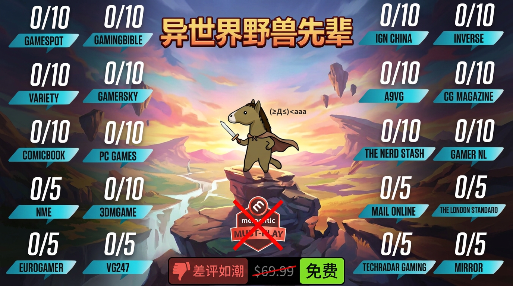
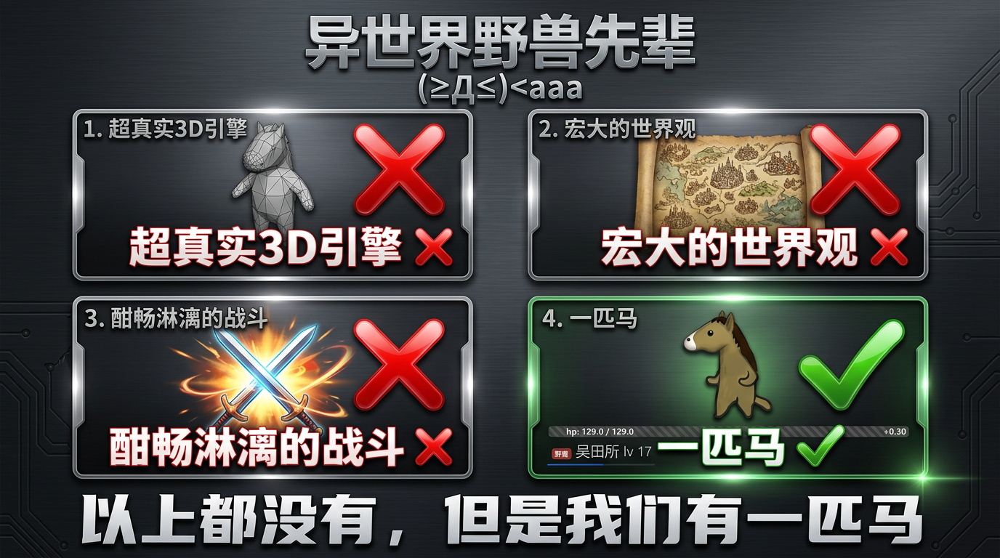

# Sur1ive.github.io
## 异世界野兽先辈

异世界野兽先辈是由大鹅自主研发的一款全新开放世界冒险游戏。 游戏发生在一个被称作「异世界」的幻想世界，在这里，被神选中的人将被授予「p眼」，导引池沼之力。玩家将扮演一位名为「野兽先辈」的神秘角色，在自由的旅行中邂逅性格各异、能力独特的同伴们，和他们一起击败远野，找回失散的亲人，同时逐步发掘「仲夏夜」的真相。

目前进度：咕了 如果真有人玩 or 能多几个stars的话再更新装备新地图新敌人新机制blabla

play：
- https://surlive.net/isekai114514/
- https://sur1ive.github.io/isekai114514/ (如果上面的挂了可以试试这个，但是国内可能没法直连)

PV：
- https://surlive.net/isekai114514/pv/ （纯 HTML 动画 + 浏览器实时合成配乐，源码在 `public/pv/`）
- 导出 MP4：`node scripts/render-pv.cjs pv.mp4`（需要 playwright 和 ffmpeg）

